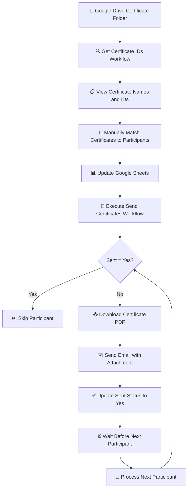

# 📜 n8n Certificate Automation

Automate certificate distribution for community events using **n8n, Google Drive, Google Sheets, and email**.

This repository contains two n8n workflows that simplify certificate distribution. The first workflow retrieves certificate files from Google Drive so their names and IDs can be matched manually with participants. The second workflow uses the updated Google Sheets data to email each participant their certificate PDF.

## ⚙️ Workflows

### 1. 🔍 Get Certificate IDs

**Purpose:** List the certificate PDFs stored in a Google Drive folder so their file IDs can be matched with participants.

**How it works:**

1. 📂 The workflow accesses the Google Drive folder containing the certificates.
2. 📄 It retrieves and lists the certificate files, including their names and file IDs.
3. 📋 The execution output displays the available certificate information.
4. 🔎 You manually identify which certificate belongs to each participant.
5. 📝 You copy the corresponding certificate ID into that participant's row in Google Sheets.

**How to execute:**

1. Open the `Get Certificate IDs` workflow in n8n.
2. 🔑 Ensure the Google Drive credentials and certificate folder are configured.
3. ▶️ Click **Execute Workflow**.
4. 📋 Open the execution output and review the certificate names and IDs.
5. 🔍 Match each certificate to the correct participant using the certificate name.
6. 📝 Copy the certificate ID into the appropriate row in your participant spreadsheet.

This workflow helps you retrieve certificate information. Matching the certificates to participant records is a manual step.

### 2. 📧 Send Certificates

**Purpose:** Send each participant their certificate by email using the participant details and certificate IDs stored in Google Sheets.

**How it works:**

1. **📊 Get Rows from Google Sheets:** Reads the participant list containing names, email addresses, certificate IDs, and sending status.
2. **🔎 Filter Sent Participants:** Checks whether a participant's `Sent` field is already `Yes`. If it is, that participant is skipped.
3. **🔁 Loop Over Items:** Processes eligible participant records one at a time.
4. **📥 Download Certificate:** Uses the certificate ID from the spreadsheet to download the corresponding PDF from Google Drive.
5. **✉️ Send Email:** Sends an email using a predefined message template and attaches the participant's certificate.
6. **✅ Update Google Sheets:** After the email node succeeds, updates the participant's `Sent` status to `Yes`.
7. **⏳ Wait:** Pauses for a configured number of seconds before processing the next participant.
8. **🔄 Repeat:** Continues until all eligible participants have been processed.

**How to execute:**

1. Open the `Send Certificates` workflow in n8n.
2. 🔑 Ensure the Google Sheets, Google Drive, and email credentials are configured.
3. 📊 Confirm that the workflow points to the correct participant spreadsheet and worksheet.
4. 🪪 Verify that every participant has the correct certificate ID.
5. ✅ Check the `Sent` column and confirm the filter conditions are correct.
6. ✉️ Review the email template, recipient field, and certificate attachment configuration.
7. ▶️ Click **Execute Workflow**.
8. 👀 Monitor the execution to ensure the emails are sent successfully.
9. 📋 Check Google Sheets to confirm that successfully processed participants are marked `Yes`.

## 📊 Google Sheets Structure

The spreadsheet used by the second workflow should contain the following information:

| Name              | Email                    | Certificate ID        | Sent |
| ----------------- | ------------------------ | --------------------- | ---- |
| Participant One   | participant1@example.com | certificate_file_id_1 |      |
| Participant Two   | participant2@example.com | certificate_file_id_2 | Yes  |
| Participant Three | participant3@example.com | certificate_file_id_3 |      |

- **👤 Name:** Participant's name.
- **📧 Email:** Email address where the certificate will be sent.
- **🪪 Certificate ID:** Google Drive file ID copied from the first workflow's output.
- **✅ Sent:** Tracks whether the certificate has already been sent.

Make sure the certificate IDs are copied into the correct participant rows before executing the sending workflow.

## 🔄 Overall Process

## 🧰 Requirements

- ⚙️ An n8n instance.
- 📂 Google Drive containing the certificate PDFs.
- 📊 Google Sheets containing participant information.
- 🔑 Google Drive, Google Sheets, and email credentials configured in n8n.
- 🪪 The correct certificate IDs matched to the participants.

## ⚠️ Important Notes

- 🔍 Always verify the certificate-to-participant mapping before sending emails.
- ✅ Participants marked `Yes` are skipped during subsequent runs.
- ⏳ The Wait node adds a delay between email operations.
- 🔁 If an email is sent successfully but the spreadsheet update fails, a later execution may send the same email again.
- 🧪 Test with a small number of participants before processing the full list.
- 🔒 Do not publish credentials, private participant information, or confidential certificates in a public repository.

---

💡 Built with **n8n** to make community event certificate distribution easier and more efficient.

⭐ Feel free to explore, adapt, and improve these workflows for your own community events!
